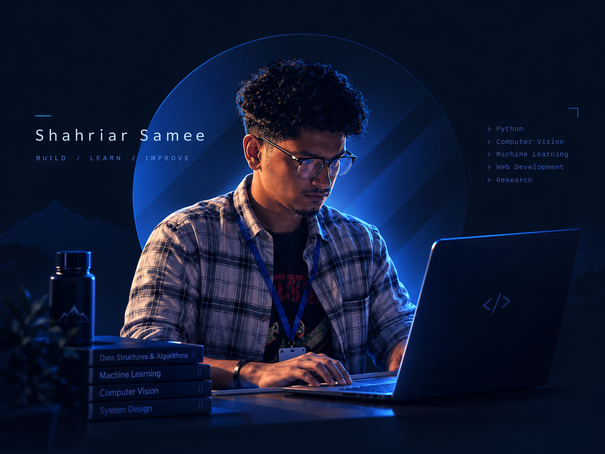
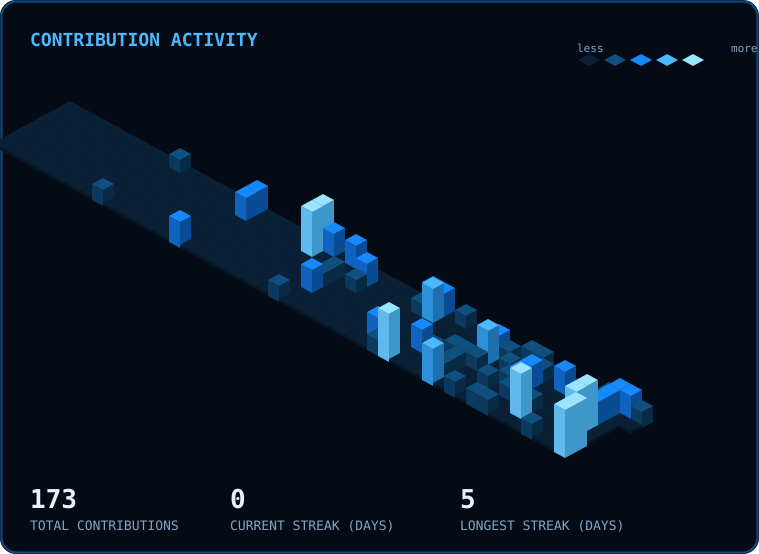
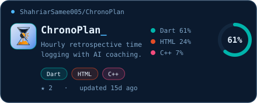
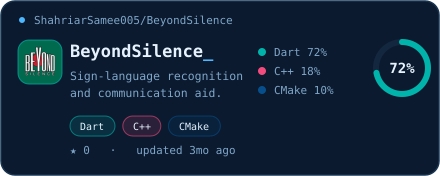
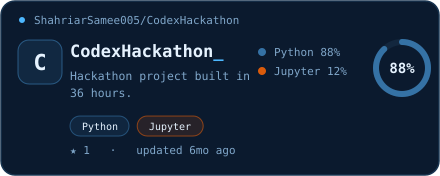
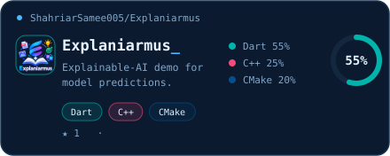
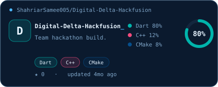
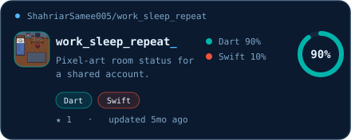
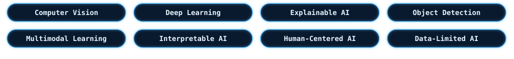

<!--
  Shahriar Samee — GitHub Profile README
  Theme: dark navy / cyber-blue. Visual panels are committed SVGs in assets/
  (render reliably, no third-party outage). Replace PORTFOLIO_URL / PDF_LINK.
-->

<!-- ====================== HERO ====================== -->

  

<!-- ====================== SOCIAL ====================== -->

  
  
  
  
  

<!-- ====================== WHO AM I ====================== -->
## { WHOAMI }

  

<table>
  <tr>
    <td width="50%" valign="top">
      <pre>
┌─[shahriar@github]─[~]
└─$ whoami
NAME       Shahriar Samee
ROLE       CSE Student
           Research Assistant
LOCATION   Bangladesh
FOCUS      AI/ML · Computer Vision
BUILD      Software · AI Systems
      </pre>
    </td>
    <td width="50%" valign="top">
      <pre>
┌─[shahriar@github]─[~]
└─$ cat focus.txt
LANGUAGES  Python · C++ · Dart
           Java · JavaScript
FRAMEWORKS Flutter · FastAPI
           Node.js · PyTorch
RESEARCH   Deep Learning
           Explainable AI
COMMUNITY  IEEE Computer Society
      </pre>
    </td>
  </tr>
</table>

  Computer Science student and Research Assistant interested in building useful software and researching practical AI systems — especially computer vision, deep learning and explainable AI.

---

<!-- ====================== TECH STACK ====================== -->
## <code>&lt;/&gt;</code> Tech Stack

  
   
  

---

<!-- ====================== RECENT ACTIVITY ====================== -->
## Recent Activity

  <!-- Custom isometric chart generated by .github/workflows/contrib-3d.yml -->
  

---

<!-- ====================== FEATURED PROJECTS ====================== -->
## Featured Projects

<!-- PINNED:START -->
<table>
<tr><td width="50%"></td><td width="50%"></td></tr>
<tr><td width="50%"></td><td width="50%"></td></tr>
<tr><td width="50%"></td><td width="50%"></td></tr>
</table>
<!-- PINNED:END -->

---

<!-- ====================== RESEARCH ====================== -->
## Research & Publications

**Research Interests**

  

**Selected Publication**

<table>
  <tr>
    <td valign="top">
      <strong>Integrating Behavioral Data and Explainable AI for Predicting Young Adult Depression</strong>
       
      ICECTE 2026 · Leading University / DeepNet R&amp;D Lab
        
      
      
      
    </td>
  </tr>
</table>
