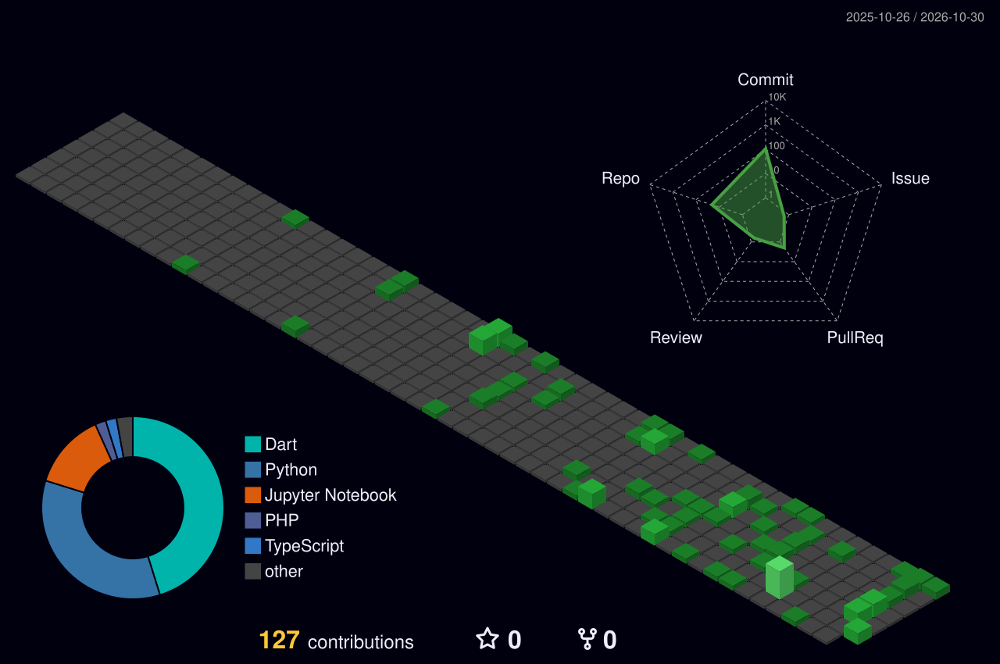

<!--
========================================================================
  Shahriar Samee — GitHub Profile README
  Theme: dark navy / cyber-blue. Palette lives in the service URLs below
  (hex without the '#'). Replace every ALL_CAPS placeholder.
  NOTE: The left profile sidebar (photo/name/bio/links/orgs) is rendered
  by GitHub from your account settings — see the setup guide, not here.
========================================================================
-->

<!-- =================== 1. SOCIAL =================== -->

<!-- =================== 2. HERO / BANNER =================== -->
<!--
  Default = dynamic themed banner (works immediately).
  To use your own night-landscape image, replace the  below with
  YOUR_BANNER_IMAGE_URL (the image must already contain the title text,
  since GitHub cannot overlay text on an image).
-->

---

<!-- =================== 3. WHO AM I =================== -->
## { WHOAMI }

<table>
<tr>
<td width="50%" valign="top">
<pre>
┌─[shahriar@github]─[~]
└─$ whoami
 USER        Shahriar Samee
 ROLE        CS Student · Research Assistant
 LOCATION    Bangladesh
 FOCUS       AI/ML · Computer Vision
 PRINCIPLE   Build. Research. Repeat.
</pre>
</td>
<td width="50%" valign="top">
<pre>
┌─[shahriar@github]─[~]
└─$ cat focus.txt
 LANGUAGES   Python · C++ · Dart · JS
 FRAMEWORKS  PyTorch · Flutter · FastAPI
 NOW         Explainable AI · Detection
 LEARNING    Multimodal Learning
 OPEN FOR    Research · Collab · Open Source
</pre>
</td>
</tr>
</table>

CS student & Research Assistant · software development + AI/ML · computer vision, deep learning, explainable AI · IEEE Computer Society Student Branch

---

<!-- =================== 4. TECH STACK =================== -->
## `</>` Tech Stack

 

---

<!-- =================== 5. RECENT ACTIVITY (3D) =================== -->
## Recent Activity

<!-- Generated by the github-profile-3d-contrib Action (see setup guide). -->

---

<!-- =================== 6. FEATURED PROJECTS (DYNAMIC) =================== -->
## Featured Projects

<!--
  The cards below are generated automatically from your PINNED repositories
  by the "Update Pinned Projects" Action. Do not edit between the markers —
  pin / unpin / reorder on your profile and it refreshes itself.
-->
<!-- PINNED:START -->

<em>Pinned projects will appear here automatically once the workflow runs.</em>

<!-- PINNED:END -->

---

<!-- =================== 7. RESEARCH & PUBLICATIONS =================== -->
## Research & Publications

**Research Interests**

**Publication**

<table>
<tr>
<td width="100%">

**Integrating Behavioral Data and Explainable AI for Predicting Young Adult Depression**
`ICECTE 2026` &nbsp;·&nbsp; Leading University / DeepNet R&D Lab

</td>
</tr>
</table>

---

<!-- =================== 8. GITHUB STATISTICS =================== -->
## GitHub Statistics

 

---

<!-- =================== 9. ACHIEVEMENTS =================== -->
## Achievements

 

 

